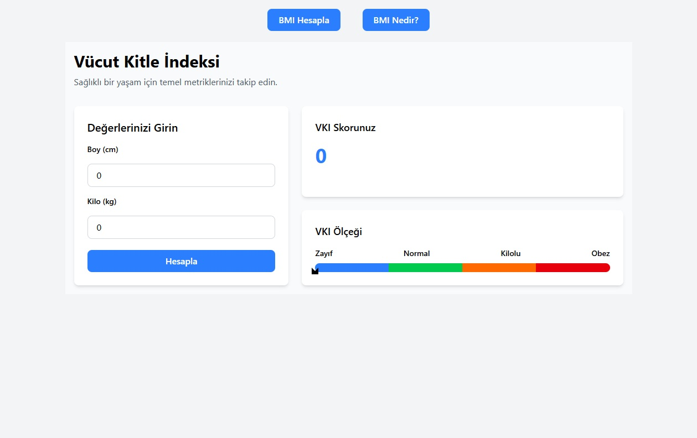
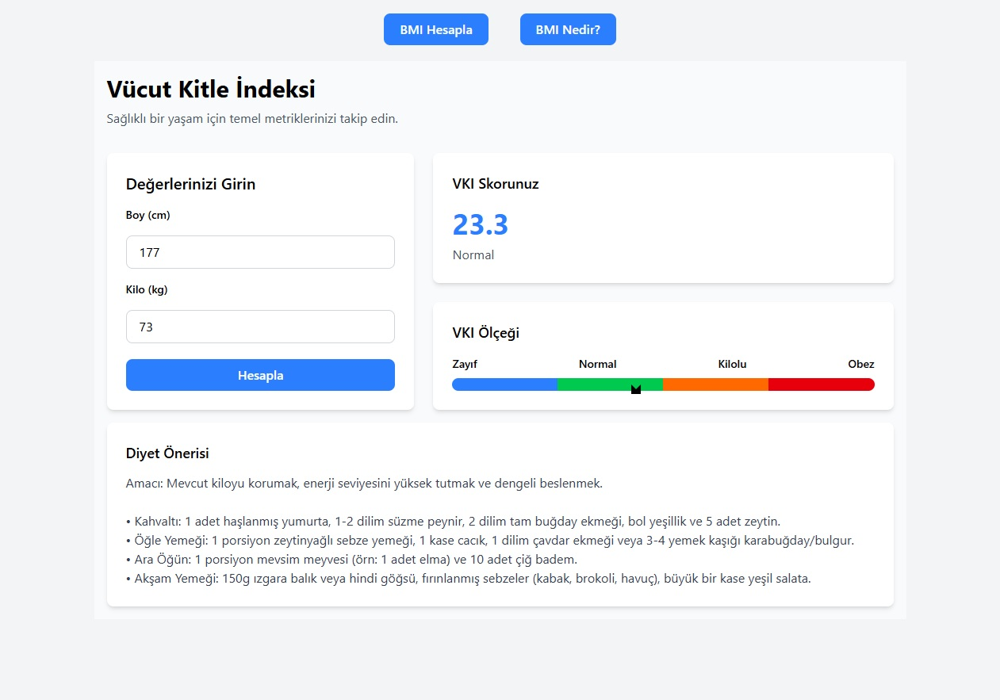
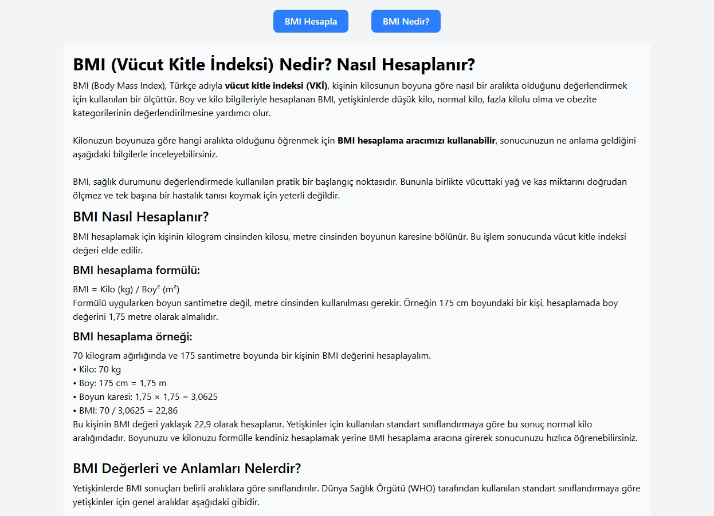

# BMI Calculator - React + Vite + Tailwind CSS - skillcamp.dev

Gereksinimler:

Bu uygulama ile kullanıcılar boy ve kilolarını girerek vücut kitle endeksini hesaplayabilirler. Çıkan sonuca göre kullanıcıya bir diyet listesi verilir.

* En az 3 componentten oluşmalıdır.(Örnek olarak “BMI hesapla”, “BMI nedir”)
* Sayfa ilk açıldığında varsayılan olarak kullanıcının vücut kitle endeksini hesaplayacağı ekran gelir.
* Hesaplama yapıldıktan sonra ekrana BMI hesabı ve kullanıcıya uygun diyet listesi görüntülenebilmelidir.
* localStorage ile tarayıcıda veriler tutulmalıdır.
* useEffect ve useState yapıları kullanılmalıdır.(React Hooks)
* Uygulamamızın URL senkronizasyonu için React Router kullanılmalıdır.
* Uygulamamızdaki butonları Styled Component yardımı ile oluşturmalıyız.
* Proje bittikten sonra Netlify üzerinden projeyi deploy etmeniz gerekmektedir.
* Uygulama önizleme bağlantısı README dosyasının en üst satırında belirtilmelidir.
* Tasarımı dilediğiniz gibi yapabilirsiniz. Hayal gücünüze güveniyoruz :)

## npm install
## npm run dev