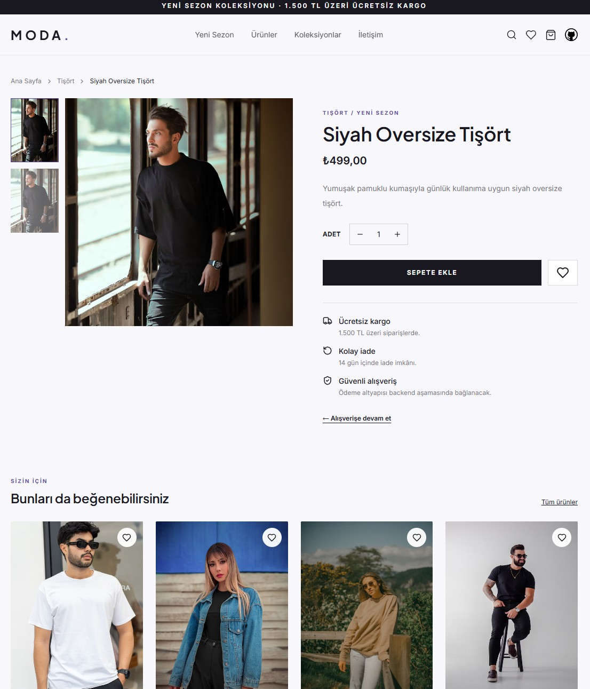
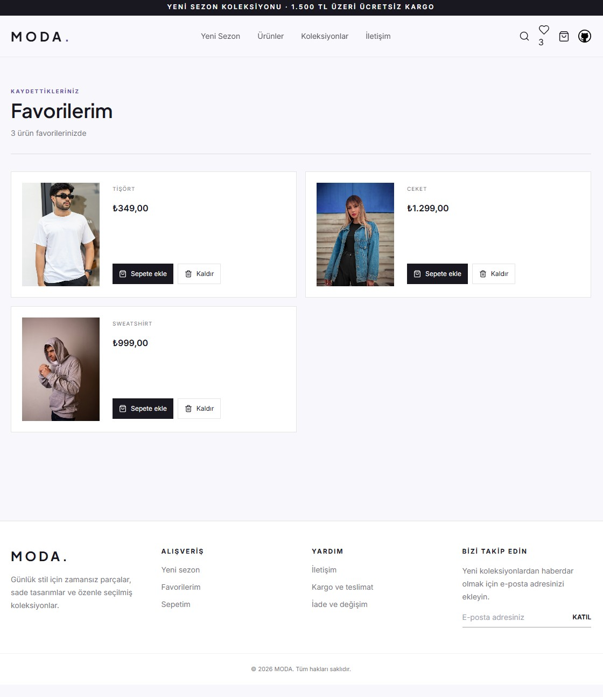
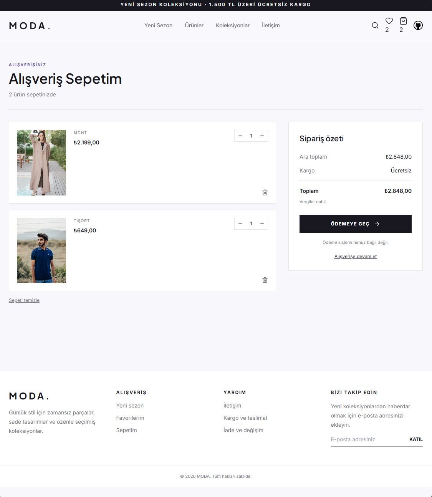
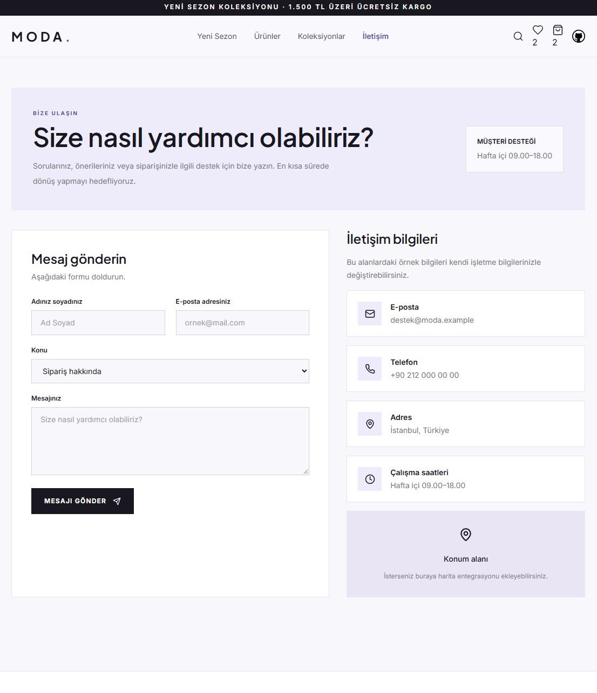

# MODA React + Vite + Redux + React Router + Tailwind CSS

[MODA](https://ecommerce-scdev.netlify.app/)

Günümüz koşulları sebebiyle bildiğiniz üzere internet alışverişi fazlasıyla yaygınlaştı. Sizden beklediğimiz kıyafet alışverişi yapabileceğimiz bir e-ticaret projesi yazmanız.

* Servis için Mockapi.io kullanabilirsiniz. Bunun için üyelik oluşturmanız gerekmektedir.
* En az 5 componentten oluşmalıdır.Örnek olarak (Ürün Kataloğu,Ürün Detay,Favoriler, Sepet,İletişim)
* Ürünler anasayfada kart halinde listelenmelidir.
* Sayfa ilk açıldığında varsayılan olarak ürünler sayfası bizi karşılamalıdır. Ürün üzerine tıklandığında o ürünün detaylarına ulaşabilmeliyiz. Detay sayfasında “Favorilere Ekle”, “Sepete Ekle” butonları bulunmalı. Hiçbirini seçmek istemiyorsak “Anasayfaya Dön” butonu ile Ürünler sayfasına geri dönebiliriz.
* Uygulamamızın URL senkronizasyonu için React Router kullanılmalıdır.
* Uygulamamızdaki butonları Styled Component yardımı ile oluşturmalıyız.
* map fonksiyonu ile kıyafetler dinamik bir şekilde uygulamamızda görüntüleyebiliriz.
* Mockaopi.io ile oluşturulan veritabanını projemize dahil etmek ve kullanmak için Axios kütüphanesi kullanılmalıdır.
* Proje bittikten sonra Netlify üzerinden projeyi deploy etmeniz gerekmektedir.
* Uygulama önizleme bağlantısı README dosyasının en üst satırında belirtilmelidir.

## Kurulum
- npm install
- npm run dev

## Sayfalar
- `/` — Ürün kataloğu
- `/products/1` — Ürün detay
- `/favorites` — Favoriler
- `/cart` — Sepet ve sipariş özeti
- `/contact` — İletişim

## Yapı
- React + Vite
- Tailwind CSS
- React Router
- Redux Toolkit / React Redux
- Ürün listesi API'den alınır ve Redux store'da tutulur.
